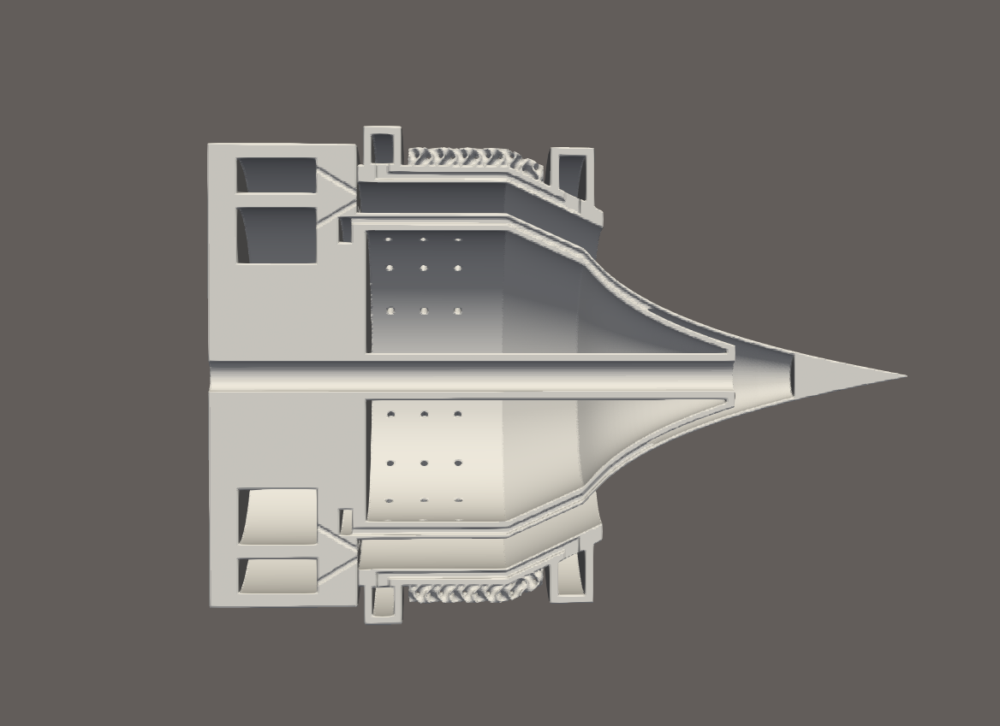

# The Design and how it got here

Research.md is the diary or just a work flow where I've noted every problem and every wrong turn and every Update note. This file is the short version: what the engine actually IS right now and why each pick got made. If you only read one file read this one.

<p align="center">
  
</p>

## What it is

A **rotating detonation rocket engine** with an **aerospike**. Hydrogen and oxygen get sprayed into a ring shaped gap then detonation waves chase eachother around that ring nonstop at high speeds, and the burnt gas leaves over a spike instead of through a bell nozzle. On paper only thus far. Nothing here has been built or fired cus who do I look like? A rocket scientist!?

```
thrust        5 kN at sea level
propellant    liquid hydrogen + liquid oxygen, 5 to 1 by weight
feed          pressure fed, no pumps
ring          120 mm across, 10 mm gap, 50 mm long, 15 bar
flow          1.70 kg/s (hydrogen 284 g/s, oxygen 1419 g/s)
nozzle        aerospike, 114 mm long
size          240 mm long, 156 mm wide, about 10 kg in copper alloy
```

## How I got here

It did NOT start as a rocket. My bumass was so tunnel visioned and stuck in train of thought that V1 and V2 were a turbojet with a detonation ring where the burner goes. Compressor, turbine, air, the whole thing. I got two full versions deep before noticing that RDEs are basically never turbine driven, they get injected like rockets. What I actually had in my head the whole time was a rocket with an aerospike. So I misread my own idea for two versions straight which is impressive in its own way.

V3 is the rocket. The old sections in Research.md stay where they are with Update notes under em cus the mistakes are part of how it went.

The way every pick got made is the same loop:

```
1. I guess from instinct
2. real papers and real math get pulled in (with Claude Assistance*)
3. the guess usually dies
4. the number that survives gets locked, loosely
```

"Loosely" matters here. Almost everything here moved at least once after being locked so yeah. Locked loosely. 

## The picks and why

| Picked | Why ?? |
|---|---|
| Rocket not turbojet | RDEs are injected like rockets. No compressor to fight the shockwaves |
| 5 kN | Same size as the aerospike LEAP 71 fired so theres a real engine to hold mine against |
| Pressure fed | Heavy tanks but basically no moving parts. Less points of failure |
| Ring at 15 bar | Medium on purpose. More pressure means smaller ring but the tanks gotta hold even more |
| Hydrogen + oxygen | All my research was already built on hydrogen. Detonates easy, cools like nothing else |
| 5 to 1 mix | I guessed 6 to 7,2. A full sweep said 5 is where push and cooling both still work |
| Ring 120 mm, 10 mm gap | Started at 90. Grew so theres room for several waves instead of one lonely one |
| Aerospike | Exhaust diamonds. Also it keeps working as the air gets thinner, a bell doesnt |
| Hydrogen cools EVERYTHING | If an oxygen channel punctures it feeds its own fire. A hydrogen leak just blows cold |
| Oxygen warmed by a heat exchanger | So it shows up at the holes as gas, not a freezing liquid that wont mix |
| 120 pairs of small holes | Jets aimed at eachother so they mash in the middle and not on the wall. Lots of small ones for an even coat |
| Holes sized for hot hydrogen | Fixed holes cant be right for hot AND cold, so I picked the case it lives in |
| 48 acoustic cavities | Quarter wave pockets in the outer wall to eat the vibration from the waves |
| Sideways pre-detonator | Kicks the first wave in one direction so it doesnt start as a mess |

## Making the body

Once the numbers agreed with eachother (one script sizes the whole thing and checks every pick against the rest) the body got generated instead of drawn by hand. It uses **PicoGK**, it's a open source kernel from LEAP 71, same idea as their engines they just describe the shape as math and let the computer grow it.

```
what got grown
- head with the hydrogen and oxygen manifolds
- outer wall with 60 cooling channels
- centre body and spike with 48 cooling channels
- 120 pairs of injector holes
- 48 acoustic cavities
- pre-detonator tube
- gyroid skin on the outside
```

The gyroid skin is the wavy lattice on the outside. More surface (great for passive cooling too), less weight and it looks insane which was honestly half the reason.

The STL files are in the [release](https://github.com/Madis-O/RDREC/releases/tag/STL).

## Testing, and what broke

Then the fun part. Three quick sims got built to see how far the design goes, and it did NOT walk out clean.

```
test bench    same hardware, throttle up and down    -> runs away cold at low heat
ring sim      the ring rolled flat, watch the waves  -> wave forms and holds
cooling sim   hydrogen through the channels          -> walls cook up
```

**The wave works.** One wave at about 3000 m/s, which is roughly 91% of the textbook speed. Ring sits around 11 bar instead of the 15 I sized for and the wave shuts the injector holes part of the time so only about 88% of the flow gets through. That was a coarse run that got cut short soo I trust the picture more than the decimals.

**The cooling does not.** Hot wall hits 2400 to 2900 K and Copper gives up at roughly around 800. There's enough hydrogen to carry the heat but it crawls through the channels at about 7 m/s, so it only soaks up 0.33 MW of the 1.6 to 2.1 MW coming in. Same as a radiator with the pump barely spinning. Channels are too fucking big. This is the biggest open problem on the whole engine.

**The heat loop runs away.** Colder hydrogen is denser so more squeezes through the fixed holes, which cools the loop more and which makes it denser again. With the low heat estimate it never settles.

I also set up OpenFOAM with detonationFoam to check things against a published solver instead of only my own scripts. First check was a plain tube of hydrogen and oxygen. It came out 13.6% too fast and I dont know why yet. Not the grid... tried that. So right now nothing here is validated against real software and I wont pretend it is.

## Whats next

```
1. redesign the cooling channels (the big one)
2. meter the hydrogen where its still cold so the loop cant run away
3. get the OpenFOAM tube check to pass
4. sim the whole engine in a slice, aerospike and exhaust included
5. the ring in OpenFOAM with real chemistry
```

I got this parked for now. Will be back long later on, might dabble in robotics sooner enough. But I've exhausted this for now. But I **will** be back.

*I am always open with my AI usage. The mathematics, the sim code and the body generation here with PicoGK were heavy lifted by Claude as I am no mathematician. The idea and the picks and the pushback are mine ^^*

[16-Nov-2026]
